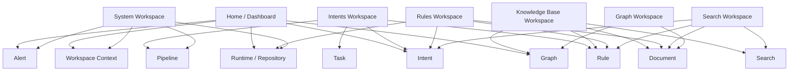
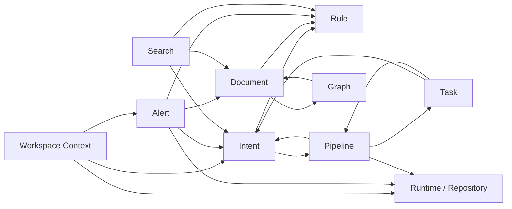

# KBX UI Module Architecture Map

## Status

This document defines the **module-first architecture map** for the KBX UI rebuild.

It exists because frontend sections and backend/runtime logic modules are **not the same thing** and should not be forced into a 1:1 structure.

## Core Rule

The UI should be organized around **frontend features and operator workflows**.

The system underneath should be organized around **logic modules with explicit dependencies**.

That means:

- core modules model the real system
- frontend features compose one or more core modules
- dashboards and workspaces are aggregation surfaces, not core modules

## Architectural Correction

The earlier high-level design was directionally correct at the page level, but incomplete at the module level.

Specifically:

- `Home` / `Dashboard` is not a core module
- `System` is not one single domain object; it is an operator surface over runtime, repo, and workspace context
- `Intents` page is built on multiple logic modules, especially `Intent`, `Task`, `Pipeline`, and `Rule`
- `Knowledge Base` page is built on `Document`, `Search`, `Rule`, and optionally `Graph`
- `Alerts` should be treated as a cross-cutting output module, not just a visual section

## Core Logic Modules

These are the backend/runtime-facing modules that should exist conceptually, even if the current implementation is not yet cleanly split.

### 1. Workspace Context

Purpose:

- current focus
- active session context
- workspace goals
- current next action
- high-level operational summary

### 2. Intent

Purpose:

- lifecycle state
- intent metadata
- decision summary
- close condition
- mutation workflow and approval state

### 3. Task

Purpose:

- tasks that belong to an intent
- task state and sequencing
- execution detail under intent work

### 4. Document

Purpose:

- knowledge-base tree
- document content
- document metadata
- verification and time state
- document issues and hot folders

### 5. Rule

Purpose:

- rule registry
- severity and enforcement
- rule grouping and applicability
- rule findings against intents, documents, workflow, metadata, and repo state

### 6. Alert

Purpose:

- aggregated signals that require operator attention
- health warnings
- gating anomalies
- risk and chaos outputs

### 7. Pipeline

Purpose:

- lifecycle models
- runtime-backed process visibility
- release/checkpoint/maintain flow visibility
- stage progression for intent and task workflows

### 8. Runtime / Repository

Purpose:

- repo state
- working tree status
- runtime bridge state
- local endpoint, node runtime, root path, and integration health

### 9. Graph

Purpose:

- entities
- relations
- graph metrics
- ontology and convergence visibility

### 10. Search

Purpose:

- cross-surface lookup and navigation
- retrieval entry point across documents and possibly intents/rules later

## Core Module Dependency Map

The following dependency map is the corrected logic-level model.

| Module | Primary Dependencies | Why |
| --- | --- | --- |
| Workspace Context | Intent, Alert, Runtime | current focus and operational summary are derived, not standalone |
| Intent | Rule, Pipeline | lifecycle and approval logic must be validated by rules and process state |
| Task | Intent, Pipeline | tasks belong to intents and move through workflow state |
| Document | Rule, Graph | documents are evaluated by rules and may feed graph/ontology state |
| Rule | none at core definition level | rules are defined centrally and applied outward to many modules |
| Alert | Rule, Runtime, Document, Intent | alerts are aggregated outputs across health, validation, and workflow signals |
| Pipeline | Intent, Task, Runtime | pipeline status depends on process state and runtime support |
| Runtime / Repository | none at core definition level | runtime state is a source module consumed by others |
| Graph | Document | graph knowledge is primarily derived from KB content and related structure |
| Search | Document, Intent, Rule | retrieval should begin with docs, then widen to intent/rule surfaces as contracts mature |

Important interpretation:

- `Rule` depends on nothing at the definition level, but its findings apply to almost everything
- `Alert` is an output aggregator, not a base entity module
- `Dashboard` does not belong in this table because it is a frontend composition layer

## Frontend Feature Modules

These are the operator-facing feature slices that the UI should expose.

They are **not** the same as the core modules.

### 1. Home / Dashboard

Depends on:

- Workspace Context
- Intent
- Alert
- Graph
- Runtime / Repository

Role:

- aggregated status and fast diagnosis

### 2. Intents Workspace

Depends on:

- Intent
- Task
- Pipeline
- Rule

Role:

- lifecycle operations and execution workspace

### 3. Knowledge Base Workspace

Depends on:

- Document
- Rule
- Search
- Graph

Role:

- browse, read, inspect, and validate KB content

### 4. Rules Workspace

Depends on:

- Rule
- Document
- Intent
- Runtime / Repository

Role:

- inspect rule catalog, severity, enforcement, and findings context

### 5. Search Workspace

Depends on:

- Search
- Document
- Intent
- Rule

Role:

- find and jump across system surfaces

### 6. System Workspace

Depends on:

- Runtime / Repository
- Alert
- Pipeline
- Workspace Context

Role:

- runtime diagnostics and environment visibility

### 7. Graph Workspace

Depends on:

- Graph
- Document

Role:

- graph metrics now, richer exploration later

## Build Sequence By Frontend Feature

The frontend should be built in this sequence.

### Phase 0: Shell

Build first:

- master layout
- compact command/header bar
- top navigation
- page frame
- local sidebar / rail primitives
- optional inspector panel primitives
- bottom status bar
- shared panel, spacing, and container language

Shell constraint:

- this phase is not complete until the app feels like a compact IDE-like operator frame rather than a broad dashboard website

This phase exists to make later module work consistent.

### Phase 1: Intents Workspace

Build in this order:

1. intent list
2. intent detail
3. intent actions / lifecycle controls
4. task list inside intent
5. task detail inside intent
6. summary blocks derived from intent/task state

### Phase 2: Knowledge Base Workspace

Build in this order:

1. document tree / list
2. document reader
3. document metadata panel
4. issue and hot-folder support blocks
5. summary blocks after the reader flow is stable

### Phase 3: Rules Workspace

Build in this order:

1. rule registry / list
2. rule detail or grouped inspection
3. findings context against docs/intents/runtime
4. summary blocks later

### Phase 4: Search Workspace

Build in this order:

1. search entry and grouped results
2. result navigation into concrete entities
3. richer cross-surface search behavior after contracts are proven

### Phase 5: System Workspace

Build in this order:

1. runtime / repo status list-style surfaces
2. detail diagnostics
3. summary cards after the lower-level surfaces are correct

### Phase 6: Home / Dashboard

Build last among the main workspaces.

Reason:

- it is an aggregation layer over other modules
- it should summarize proven module contracts rather than invent them

## Per-Module Build Rule

For each module or frontend feature, the correct build order is:

1. list / inventory / entry surface
2. detail surface
3. action surface
4. summary blocks
5. cross-module aggregation

Do not reverse this order.

## Required Module Scan Before Implementation

Before implementing any module, scan the existing system for that module.

Minimum scan targets:

- current UI behavior in the legacy shell
- current bridge/runtime contract
- current backend coupling with other modules
- missing boundaries that would force backend refactor before clean UI work

If scanning shows that a module is still mixed together with another module in the runtime contract, record that as a backend refactor requirement before pretending the frontend modules are cleanly separated.

## Frontend Feature To Core Module Map

## Core Dependency Graph

## Feature List Rewritten For The New Design

### Home / Dashboard

- current focus and current next action
- active intent summary
- milestone and roadmap rollup
- workspace goals and gate summary
- aggregated alert queue
- chaos and health indicators
- runtime and repo status snapshot
- graph snapshot only as summary, not as deep explorer

### Intents Workspace

- intent list with state, priority, and block reason
- draft intent creation
- intent detail summary
- lifecycle actions: approve, preview, apply, close, archive, retrospective, impact-related actions
- task board scoped to current intent
- metadata edit surface

### Knowledge Base Workspace

- KB tree browser
- document reader
- document metadata panel
- verification and time-state visibility
- hot folders and document issue visibility
- contextual rule-related document insight

### Rules Workspace

- rule landscape by domain
- enforcement model visibility
- registry table with rule code, severity, and short description
- findings context against documents, intents, workflow, metadata, and repo/workspace state

### Search Workspace

- cross-surface search entry
- grouped results
- navigation into document, intent, or rule-adjacent targets when contracts support it

### System Workspace

- local UI endpoint and CLI bridge visibility
- node/runtime/workspace root visibility
- working tree and repo status
- current session / active intent tracking
- pipeline runtime support visibility

### Graph Workspace

- graph metrics
- ontology / convergence summary
- placeholder-first graph exploration until backend support becomes cleaner

## Backend Refactor Trigger Points

If the backend/runtime still mixes these concerns together, treat that as a refactor requirement rather than a frontend naming problem.

Refactor is required when:

- task data is inseparable from intent payloads in a way that blocks independent task views
- rule findings are mixed directly into dashboard-only responses with no reusable contract
- runtime/repo signals and alert outputs are collapsed into one generic status blob
- pipeline state is not modeled separately from intent metadata
- search cannot clearly distinguish document hits from other hit types

## Final Rule

The rebuild should not ask:

- "What pages do we have?"

It should ask:

- "What logic modules exist?"
- "What operator workflows do we expose?"
- "Which frontend feature composes which modules?"

That is the correct alignment model for the new KBX UI design.